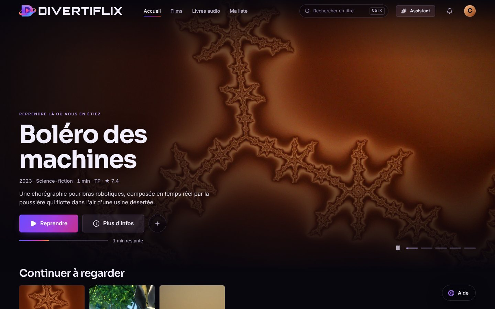
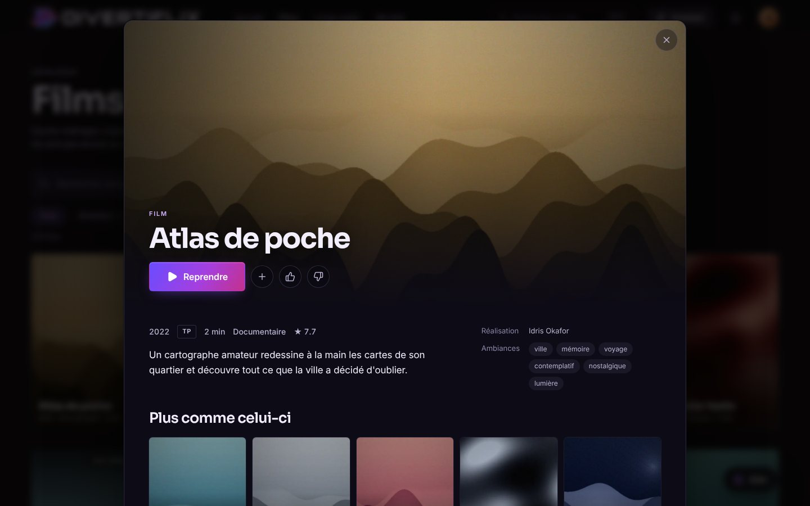
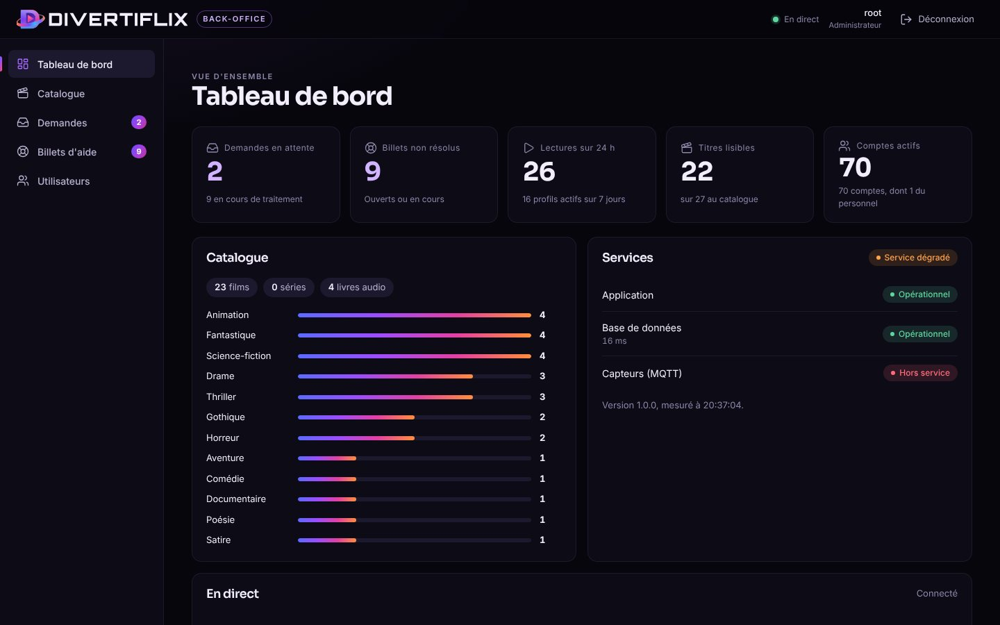
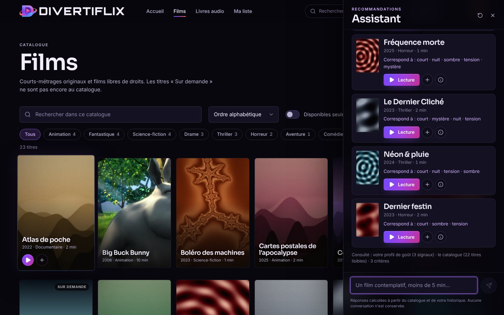
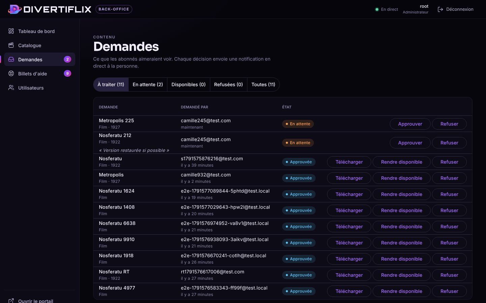

# Divertiflix

Plateforme de vidéo sur demande de l'entreprise fictive Divertiflix (cours 420-511-SH, Cégep de Sherbrooke). Un portail pour les
abonnés, un back-office pour le personnel, une API, et un moteur de recommandation expliquable. Tout fonctionne de bout en bout :
aucune fonction n'est factice.



## Ce que ça fait

**Portail abonné** (React) : accueil personnalisé (à la une, reprise de lecture, « parce que vous avez regardé », tendances,
nouveautés), films et livres audio avec filtres, fiche de titre, lecteur HLS avec reprise, lecteur audio persistant pendant la
navigation, liste personnelle, pouces haut et bas, profils multiples, palette de commandes (Ctrl+K), assistant de recommandation,
demande de titre, aide avec fil de discussion, notifications en direct, français et anglais.

**Back-office** (Angular) : tableau de bord (compteurs, état des services, flux en direct), catalogue complet, demandes
(approuver, télécharger, rendre disponible, refuser avec raison), billets d'aide (réponse depuis le fil), utilisateurs (rôles,
activation). Deux rôles : Admin (tout) et Support (lecture du catalogue, des demandes et des billets avec le courriel de leurs auteurs,
réponses aux billets ; ni la liste des comptes ni les décisions sur les demandes).

**API** (ASP.NET Core 9) : authentification JWT avec jetons de rafraîchissement à usage unique, recommandations, assistant,
demandes, billets, notifications SignalR, synchronisation Active Directory et Audiobookshelf, médias servis par URL signées,
pont MQTT vers les capteurs ESP32.

| Portail | Back-office |
| --- | --- |
|  |  |
|  |  |

## Démarrage rapide (développement)

Prérequis : .NET 9, Node 22.22.3 ou plus, Docker. Les trois derniers serveurs restent au premier plan : un terminal chacun.

```bash
docker compose up -d                       # PostgreSQL, Mosquitto, Redis (ports sur 127.0.0.1)
npm install
cd apps/api && ASPNETCORE_ENVIRONMENT=Development dotnet run --project src/Divertiflix.Api --urls http://localhost:5080   # terminal 1
npm run web                                # terminal 2, portail : http://localhost:5173
npm start -w admin-angular                 # terminal 3, back-office : http://localhost:4200
```

Compte administrateur de développement : `root` / `boom123$` (n'existe qu'en développement : hors développement,
`Seed__AdminPassword` est obligatoire). Un abonné se crée depuis l'écran d'inscription du portail.

`./start-all.sh` lance tout d'un coup, `./stop-all.sh` l'arrête.

## Tests

| Suite | Commande | Contenu |
| --- | --- | --- |
| API (xUnit) | `cd apps/api && dotnet test` | 342 tests : moteur, analyseur de requêtes, accueil, assistant, flux de travail, comptes et sessions, concurrence, synchronisations, temps réel. Base PostgreSQL jetable par classe. |
| Portail (Vitest) | `npm test` | 159 tests : clés de traduction, client API et session, composants, hooks, pages, charte graphique. |
| Back-office (Angular) | `cd apps/admin-angular && npx ng test --watch=false` | 96 tests : services, garde-fous de rôle, pages et fenêtres. |
| Démo hébergée (Vitest) | `cd packages/demo && npx vitest run` | 37 tests du faux serveur. |
| Bout en bout (Playwright) | `E2E_CHROME=/chemin/chrome npm run e2e` | 14 parcours réels sur la pile complète, dont les notifications en direct entre portail et back-office. |

Les parcours de bout en bout demandent l'API, PostgreSQL et un Chrome capable de lire le H.264 (le Chromium de Playwright ne le lit
pas). Sans portail ni back-office déjà lancés, Playwright démarre les serveurs de développement. Pour les lancer à répétition, relever
les plafonds de débit de l'API : `RateLimit__AuthPerMinute=100000`. Pour viser un serveur installé par `install-serveur.sh` (nginx, CSP
comprise), `E2E_BASE_URL`, `E2E_ADMIN_URL`, `E2E_ADMIN` et `E2E_ADMIN_PASSWORD` remplacent les adresses et le compte de développement.
Le pipeline GitLab exécute les quatre autres suites, pas ceux-ci.

## Organisation du dépôt

```
apps/api/            API .NET (Domain, Infrastructure, Api, Tests)
apps/web-react/      portail abonné
apps/admin-angular/  back-office
packages/api-client/ types et client générés depuis l'OpenAPI, partagés par les deux fronts
packages/brand/      logo (SVG) et jetons de design partagés
packages/demo/       faux serveur en TypeScript pour la démo hébergée (sans API)
tools/demo-media/    génération des médias de démonstration (ffmpeg)
tools/brand/         génération du logo et des icônes
tools/recsys-eval/   évaluation du moteur sur MovieLens
e2e/                 parcours Playwright
infra/               configuration Mosquitto
scripts/             gabarits Python de synchronisation Active Directory et Audiobookshelf (non exécutés ici)
docs/                architecture, sécurité, recommandation, démonstration, fichiers générés, captures
install-serveur.sh   installation et déploiement sur un serveur Ubuntu (voir plus bas)
start-all.sh, stop-all.sh   lancent et arrêtent tout le développement ; docker-compose.yml, .gitlab-ci.yml
```

## Documentation

- [Architecture](docs/architecture.md) : composants, flux, décisions.
- [Sécurité](docs/securite.md) : ce qui est protégé, comment, et ce qui reste à faire.
- [Recommandation](docs/recommandation.md) : le moteur, l'assistant, et son [évaluation sur MovieLens](docs/evaluation-movielens.md).
- [Démonstration](docs/demo.md) : déroulé de 7 minutes.
- [Démo hébergée](docs/demo-hebergee.md) : portail et back-office jouables dans le navigateur, sans serveur.
- [Fichiers générés](docs/regeneration.md) : ce qui n'est pas versionné et la commande qui le reproduit.
- `memoire.md` : décisions et pièges rencontrés. `logiciels.md` : tout ce qui est installé. `progres.md` : avancement.

## Déploiement

`sudo ./install-serveur.sh` sur un Ubuntu 22.04 ou 24.04 (idempotent : le relancer redéploie). Il installe les dépendances, génère
les secrets dans `/opt/divertiflix/.env` (permissions 600), démarre l'infrastructure, compile l'API et les deux fronts, configure le
service systemd durci et nginx (en-têtes de sécurité, CSP stricte, cache des fichiers à empreinte, WebSocket pour le temps réel,
limitation de débit par adresse IPv4 ou par préfixe /64 en IPv6, journal d'accès où les jetons de flux et de SignalR sont masqués).
L'API reste en service pendant la compilation et n'est arrêtée que le temps de remplacer ses fichiers. Le mot de passe administrateur
généré s'affiche à la fin dans un terminal ; sinon il est dans `/opt/divertiflix/.env`. Le pipeline GitLab exécute les tests avant tout
déploiement.

HTTPS : avec `DOMAIN` et `CERTBOT_EMAIL`, donnés une première fois, le script configure Let's Encrypt. Ces deux valeurs ne sont pas des
secrets : elles sont enregistrées dans `/opt/divertiflix/.env` et relues aux exécutions suivantes, donc le pipeline n'a besoin d'aucune
variable pour garder HTTPS (nginx est pourtant réécrit à chaque exécution). Un serveur installé avant cette mémorisation est reconnu à
son unique certificat de `/etc/letsencrypt/live/` ; avec plusieurs certificats, le script s'arrête avant de toucher à nginx et demande
`DOMAIN`. Un certificat déjà émis n'est jamais supprimé ni réémis : le script le réinstalle tel quel dans le site réécrit (`certbot
install`, sans contacter Let's Encrypt, sans passage par un nginx en HTTP seul ; le renouvellement reste celui de `certbot.timer`), et
si cette réinstallation échoue il remet l'ancien site HTTPS en place et se termine en erreur (le job du pipeline échoue). Sans domaine,
ou avec un domaine sans e-mail ni certificat, le site reste en HTTP. Seule la variable `FORCE_HTTP=1` ramène nginx en HTTP seul : elle vaut
pour l'exécution où elle est donnée (la garder dans les variables CI/CD pour que ce soit durable), le certificat reste sur le disque, et
l'exécution suivante sans elle rétablit HTTPS. Elle supprime l'en-tête HSTS : les navigateurs qui l'ont retenu (un an) n'atteignent plus
le site tant que HTTPS n'est pas rétabli. La version de nginx est masquée pour tous les serveurs, y compris le bloc du port 80 que
certbot ajoute pour la redirection (directive `server_tokens` au niveau `http`).

## Contenus de démonstration et licences

Les affiches, fonds, courts-métrages et livres audio du catalogue de démonstration sont **générés** par `tools/demo-media`
(images génératives, vidéos et voix de synthèse produites avec ffmpeg) : aucune œuvre protégée n'est incluse. « Big Buck Bunny »
est © Blender Foundation, licence CC BY 3.0 (crédit affiché sur sa fiche). Les textes des livres audio sont du domaine public.
Le jeu de données MovieLens, utilisé uniquement pour l'évaluation, n'est pas versionné (GroupLens Research, Université du Minnesota).

## Identité visuelle

Le logo, recréé en SVG d'après le logo officiel (fond transparent), est dans `packages/brand` ; les jetons de couleur, de police et
de mouvement y sont aussi, et alimentent le portail et le back-office : une seule source. Voir `packages/brand/README.md`.
